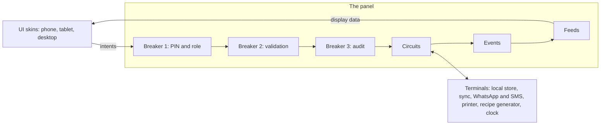

# Cake Shop POS: Master Blueprint

**Version:** 0.3 | **Date:** 2 Oct 2026 | **Status:** Graph locked. First slice built. Phase 2a (shop server) built and tested (see section 18)

This is the single source of truth for the project. When something feels unclear, contradictory, or lost, come back here, find the section by its ID, and reconcile.

---

## 0. How to use this document

**Stable IDs.** Everything that can be referred to has an ID that never changes: sections (§), decisions (D-xx), business rules (BR-xx), assumptions (A-xx), open questions (Q-xx). Refer to these in conversation ("check BR-12") instead of re-explaining.

**Reconciliation protocol (when we get lost)**
1. Find the topic by section. Read the rule or definition there first.
2. Check the **Decision log** (§16) for *why* it is that way, including anything it superseded.
3. If new information conflicts with the document, do not quietly change the section. Add a new decision entry, mark the old one superseded, update the affected sections, and bump the version in the change log (§17).
4. If it is unresolved, add it to **Open questions** (§15) with a tag for who decides.
5. If it is a good idea that is not for now, add it to **Parked** (§13.3).

**Status markers.** *Settled* means decided by the owner. *Assumption* means I filled a gap and it needs confirming (see §14). *Open* means undecided (see §15). Anything unmarked is settled.

---

## 1. Vision and scope

### 1.1 What this is
A point-of-sale and operations system for a **cake shop**, built around **orders**. It handles two kinds of sales: **catalogue goods** (ready-made items kept in the shop) and **custom cake orders** (one-off designs made for a delivery date). It also covers production, ingredient usage, stock, staff communication, and owner oversight.

### 1.2 Goals
- **G-1.** Every order, payment, and delivery is recorded accurately, so cash and stock can be reconciled at the end of the day.
- **G-2.** Bakers always know what to make and by when, and ingredient usage is captured with a check by Inventory.
- **G-3.** Staff coordinate through structured requests, notes, and alerts instead of shouting across the shop or relying on memory.
- **G-4.** The system keeps working when the internet drops.
- **G-5.** The owner can see what happened and who did it, without being present.

### 1.3 Non-goals for v1
- Tax handling and multi-currency (single shop, single currency).
- Multiple branches.
- Recording transport cost (kept outside the system, BR-09).
- Customer-facing catalogue sharing or online ordering.
- Free chat between staff (BR-17).
- Suppliers and purchasing (D-31).

### 1.4 Proposed success measures *(proposed, not yet agreed)*
- A catalogue phone order can be entered in under 90 seconds.
- The end-of-day count difference for counter goods trends down week over week.
- At least 90% of ingredient usage reports are confirmed by Inventory the same day.
- Every cash payment recorded can be traced to a person and a time.

---

## 2. Glossary

| Term | Meaning |
|---|---|
| **Catalogue goods** | Ready-made items always kept in the shop, with variations (size, filling, dietary). Sold at the counter or on a phone request. Same thing as "counter goods" |
| **Custom cake** | A one-off design made to order. Priced by an owner quote, delivered on an agreed date |
| **Combination** | One specific version of a catalogue product, such as "Chocolate Fudge, 8-inch, Vanilla cream, Eggless". Has its own price and stock count |
| **Option group / value** | An axis of variation (Size, Filling, Dietary) and its choices |
| **Order line** | One item on an order. Either a catalogue line or a custom cake line |
| **Request** | A structured message to a role with a lifecycle (sent, seen, acknowledged, resolved) |
| **Alert** | A request generated by the system instead of a person |
| **Count difference** | The gap between expected stock and what was physically counted. (Earlier called "variance"; that word now means *variation*.) |
| **Panel** | The central layer that holds all logic and communication. The UI talks only to it |
| **Circuit** | A named capability inside the panel (Orders, Payments, Stock, and so on) |
| **Intent** | A plain instruction the UI sends to the panel ("record payment") |
| **Feed** | Ready-to-display data the panel provides to the UI ("the baker queue") |
| **Terminal** | A labeled connection from the panel to the outside: storage, WhatsApp/SMS, printer, recipe generator, clock |
| **Outbox** | The queue of things waiting to be sent or synced when the connection returns |

---

## 3. Users and roles

### 3.1 Roles
| Role | Purpose |
|---|---|
| **Owner** | Full oversight, prices, quotes, refunds, closing review, announcements, reports, audit log |
| **Cashier** | Takes orders and payments, hands over and delivers catalogue orders, enters phone requests |
| **Baker** | Sees the production queue, logs finished batches, reports ingredient usage |
| **Inventory** | Manages stock, confirms ingredient usage, handles stock requests |
| **IT** | Technical view only (panel map). No access to business data by default (A-06) |

### 3.2 Permission matrix *(rows marked A-xx are assumptions to confirm)*
| Capability | Owner | Cashier | Baker | Inventory | IT |
|---|:-:|:-:|:-:|:-:|:-:|
| View catalogue | ✔ | ✔ | ✔ | ✔ | |
| Create/edit products, combinations, prices (A-01) | ✔ | | | | |
| Create/edit orders | ✔ | ✔ | | | |
| Record payments | ✔ | ✔ | | | |
| Allow partial-payment exception (A-02) | ✔ | ✔ | | | |
| Approve refund / cancel with money decision | ✔ | | | | |
| Quote a custom cake price | ✔ | | | | |
| Update production status | ✔ | | ✔ | | |
| Report ingredient usage | | | ✔ | | |
| Confirm ingredient usage | ✔ | | | ✔ | |
| Log finished batches | ✔ | | ✔ | | |
| Adjust stock / set reorder levels and ranges (A-03) | ✔ | | | ✔ | |
| Daily counter count (A-04) | ✔ | ✔ | | ✔ | |
| Closing review | ✔ | | | | |
| Send requests, add order notes | ✔ | ✔ | ✔ | ✔ | |
| Post announcements | ✔ | | | | |
| View reports | ✔ | | | | |
| View audit log | ✔ | | | | |
| View panel map | | | | | ✔ |
| Manage staff and PINs (A-05) | ✔ | | | | |

### 3.3 Sign-in
Every person signs in with a **PIN**, so each action is tied to a named person, including on shared tablets. Quick switching between staff is supported.

---

## 4. Domain model

Fields marked *(required)* must be present. Everything else is optional. Every record carries `id`, `created_at`, and `created_by` unless noted.

### 4.1 Customer
- `name` *(required)*
- `contacts[]`: type (phone, WhatsApp, email, other), value, primary flag. At least one contact is recommended but not forced
- `notes` (free text)
- Delivery address is **not** stored here. It belongs on the order, because it can differ per order (D-22)

### 4.2 Catalogue

**Product**: `name` *(required)*, `category`, `description`, `photos[]`, `status` (active or archived), `available_today` (toggle), `allergens[]` (declared).

**OptionGroup** (shared library, reused across products): `name` (Size/servings, Filling, Dietary), `selection` (single or multi), `required`.

**OptionValue**: `group`, `label`, `allergens[]`. Example values: Size: "Slice", "6-inch"; Filling: "Vanilla cream"; Dietary: "None", "Eggless", "Gluten-free", "Sugar-free".

**Combination** (the variant grid): `product`, `values` (one value per group), `price` *(required, set manually by the owner)*, `stock_count`, `status` (available or unavailable), optional `photo`.
- Generated by the system from the option values the owner selects for a product, so the owner fills in prices instead of creating rows.
- Bulk helpers: fill a column, copy a price across fillings.
- A combination that should not exist is marked **unavailable** (this replaces any rules engine).

**Rules**
- Products are **archived, never deleted** (BR-10).
- The catalogue is **staff-facing only** in v1: photos, sizes, prices, live availability, and an "add to order" action.

### 4.3 Counter stock and the counter day
- **Batch**: `combination`, `qty`, `logged_by`, `at` (bakers log finished batches).
- **CounterDay**: `date`, `opening_counts`, `batches[]`, `sales` (derived from completed lines), `adjustments[]`, `daily_count` (per combination), `count_differences[]`, `closing_review_request`.
- **Expected count** = opening + batches − completed sales − adjustments.
- **CountDifference**: `combination`, `expected`, `counted`, `difference`, `counted_by`, `at`.
- **Adjustment**: `combination`, `qty`, `reason` (carry over, markdown, write-off, correction, shortfall at completion), `decided_by`.
- **Markdown**: a temporary counter price for a combination for that day.

### 4.4 Order and order lines

**Order**
- `number` (human-readable, unique across devices, BR-26), `customer`, `source` (walk-in or phone).
- `delivery_date`, `fulfilment` (pickup or delivery), `delivery_address` (required if delivery).
- `lines[]`, `payments[]`, `refunds[]`, `notes[]`, `attachments[]`.
- `status` is **derived from its lines** (A-07). `payment_status` is derived from payments (§5.3).

**Catalogue line**: `combination`, `qty`, and a **snapshot** frozen at entry (product name, chosen options, price, allergens), so later catalogue edits never change existing orders (BR-11).

**Custom cake line**: structured attributes for the recipe generator, plus free text.
- `servings_or_size`, `flavor`, `filling`, `layers`, `dietary`, `decoration_notes`, `inscription` (Q-04 confirms the exact set).
- `reference_photos[]` (from the customer's design idea).
- `quote_request` (link), `quoted_price`, `quoted_by`.
- `handover_photo` (optional photo of the finished cake).

### 4.5 Payments and refunds
- **Payment**: `order`, `method` (cash default; card, bank transfer, mobile money), `amount`, `received_by`, `received_at`, `reference` (optional, for non-cash).
- **Refund**: `order`, `amount`, `reason` *(required)*, `approved_by` *(owner only)*, `method`, `at`.

### 4.6 Delivery record
`order`, `address`, `status` (pending, out for delivery, delivered, not delivered), `delivered_by_name`, `delivered_by_contact` (optional), `at`, `notes`. Applies to both kinds of order. The person delivering can be someone outside the staff list (D-29).

### 4.7 Production and the ingredient usage chain
- **UsageSuggestion**: generated per custom cake line from its attributes. A list of ingredients with suggested quantities.
- **UsageReport** (baker): ticked ingredients, extras added, and for each a **preset range** selected by tap. Extras can be ingredients not on the suggestion.
- **UsageConfirmation** (Inventory): the exact quantity per ingredient.
- **StockMovement**: created **only** at confirmation. One ledger for all stock kinds.
- **IngredientRange**: `ingredient`, `label`, `min`, `max`, `unit`. Preset per ingredient (D-14).

### 4.8 Inventory
`name`, `kind` (ingredient, finished good, packaging), `unit`, `on_hand`, `pending_confirmation`, `reorder_level`, `allergens[]`, `ranges[]`.
- Finished goods are the combinations' `stock_count` values.
- **Days of stock left** = `on_hand` / average daily *confirmed* usage over a rolling window (BR-14).

### 4.9 Messages and alerts
- **OrderNote**: `order`, `author`, `text`. A running thread. No lifecycle.
- **Request**: `type` (manual or system), `from`, `to_role`, `subject`, `body`, `links` (order, stock item), `status`, `timeline[]` (who saw, claimed, resolved, and when), optional `escalation_after`.
- **Announcement**: `author` (owner), `body`, `requires_ack`, `seen_by[]`, `acked_by[]`.
- **Alert**: a system-generated Request with `severity`, `dedupe_key`, and a `critical` flag (§8).

### 4.10 Audit and outbox
- **AuditEntry**: `actor`, `role`, `intent`, `target`, `before/after summary`, `at`, `device`. Written automatically by a breaker (BR-21).
- **OutboxItem**: `kind` (sync, WhatsApp, SMS, print, recipe generation), `payload`, `created_at` (original time is kept), `attempts`, `status`.

---

## 5. Lifecycles

### 5.1 Custom cake order (per line)
```
Draft → Awaiting quote → New → In production → [Decorating] → Ready → Completed
                          ↘ Cancelled (any state before Completed, owner decides money)
```
- *Awaiting quote*: the cashier has sent the owner a request; resolving it fills `quoted_price` (BR-05, A-08).
- *Decorating* is an optional stage the owner can switch on (D-11).
- Payment is normally taken when the order moves to **New**.

### 5.2 Catalogue order (per line)
```
New → Ready for handover → [Out for delivery] → Completed
                            ↘ Cancelled
```
- The **cashier** moves it through every step (D-30).
- Stock decrements at **Completed** (BR-03).

### 5.3 Payment status (derived)
Unpaid → Partial → Paid. Refunds add Partially refunded and Refunded. The balance is `total − payments + refunds`.

### 5.4 Request
`Sent → Seen → Acknowledged → Resolved`
- **Seen** is tracked per person.
- **Acknowledged**: one person claims it, and the request shows who owns it.
- **Resolved**: only by the sender or the owner. The sender is notified.

> **Quote requests** (BR-05) use a shorter version of this lifecycle, built before the general Requests system: `Sent → Seen → Quoted` (or `Declined`, or `Withdrawn` by the sender or owner). The owner's answer closes it, so there is no separate "Acknowledged" step. When the Messages circuit is built, quote requests should appear in the same inbox (see D-55).

### 5.5 Announcement
`Sent → Seen`, or `Sent → Seen → Acknowledged` when `requires_ack` is set.

### 5.6 Ingredient usage chain
`Suggested → Reported → Confirmed → Stock decrements`
- Reporting auto-creates a request to Inventory (BR-13).
- Between report and confirmation the ingredient shows as **pending confirmation**.

### 5.7 Counter day
`Open → Counted → Closing review requested → Reviewed (per-item decisions) → Closed`

### 5.8 Delivery
`Pending → Out for delivery → Delivered | Not delivered`

---

## 6. Business rules

| ID | Rule |
|---|---|
| **BR-01** | An order can contain catalogue lines, custom lines, or both |
| **BR-02** | A catalogue line takes its price from the combination at the time of entry |
| **BR-03** | Catalogue stock decrements only when the order is **Completed**. No reservation. The catalogue shows *on hand* and *committed on open orders*, and warns when committed exceeds on hand. Completing with a shortfall is allowed and is logged as a count difference (A-09) |
| **BR-04** | No minimum-notice rule exists. Catalogue goods are always in the shop, and custom cake dates are agreed with the customer |
| **BR-05** | A custom cake's price comes from an owner quote, delivered through a request. The line is not confirmed until the quote is resolved |
| **BR-06** | Payment is normally full at order time. Exceptions are allowed and leave a balance |
| **BR-07** | Cash is the default method. Card, bank transfer, and mobile money can be recorded with an optional reference |
| **BR-08** | Cancellation and refund money decisions are owner-only, with a reason |
| **BR-09** | Transport cost is not recorded in the system |
| **BR-10** | Products are archived, never deleted. Archived items leave the sell screen but stay in records |
| **BR-11** | Orders freeze a snapshot of chosen options and price, so catalogue edits never rewrite history |
| **BR-12** | Stock decrements from ingredient usage only at **confirmation**. A report alone never moves stock |
| **BR-13** | Submitting a usage report auto-creates a request to Inventory. Resolving it is the confirmation |
| **BR-14** | Days of stock left uses **confirmed** usage only, over a rolling window (default 14 days, A-10). With too little history it shows "not enough data" |
| **BR-15** | Requests follow §5.4. Only the sender or owner can resolve |
| **BR-16** | Only the owner can post announcements. They can require acknowledgement |
| **BR-17** | There is no free chat. Communication happens only through order notes, requests, and announcements |
| **BR-18** | The daily counter count is compared to the expected count, and any gap becomes a count difference record |
| **BR-19** | At closing, a request to the owner is auto-created. For each unsold item the owner chooses carry over, mark down, or write off |
| **BR-20** | A markdown sets a temporary counter price for that combination for that day |
| **BR-21** | Every intent passes the breakers in order (PIN and role, validation, audit) before reaching a circuit. Every state change is audited |
| **BR-22** | The UI holds no business logic. Totals, validation, permissions, and availability are computed by the panel. The UI only renders feeds and sends intents |
| **BR-23** | Alerts are de-duplicated: one open alert per `dedupe_key` until it is resolved |
| **BR-24** | Critical alerts also go to the owner by WhatsApp/SMS through the outbox, at most one message per `dedupe_key` until resolved |
| **BR-25** | Receipts can be printed and/or sent by WhatsApp/SMS. They include order number, items with options, allergens, payments, balance, and delivery date |
| **BR-26** | Order numbers are unique across devices (for example a device prefix plus a sequence), so offline devices never collide |
| **BR-28** | A custom cake needs a delivery date before the owner can be asked to price it. Payment is refused while any custom cake on the order has no price |
| **BR-29** | The cashier may remove a custom cake before it is priced and paid. After that, or once baking starts, only the owner may cancel it, and any refund is a separate owner decision (BR-08) |
| **BR-30** | The owner may change a quoted price only until baking starts, with a reason. The change is audited and warns about money already taken |
| **BR-31** | Custom cakes use ingredients, not counter stock, so handing one over never changes a catalogue stock count |
| **BR-32** | A usage report never moves stock. It shows as pending. Stock goes down only when Inventory confirms exact figures (BR-12). Confirming the same report twice does nothing the second time |
| **BR-33** | Confirmed usage cannot take stock below zero. The shortfall is recorded on the movement and a warning asks for a count |
| **BR-34** | The ingredient suggestion is made once, when baking starts, from the recipe lines that fit the cake. Later recipe changes do not rewrite it |
| **BR-27** | Days-of-stock-left and stock alerts consider ingredients and packaging. Finished goods use the counter count |
| **BR-35** | Alerts are raised and cleared by the system from the data, never by a screen. An alert that is acknowledged or cleared before its message is sent is not sent |
| **BR-36** | Every new alert is sent once per person per channel they chose. A failed send is retried after 1, 2, 5, 15, 60 and 180 minutes, then marked failed and visible in the log. Sending never happens inside a database transaction and never delays an instruction |
| **BR-37** | An ingredient's stock is kept in one base unit (kg, l or pcs). Any other unit is converted when typed and never stored |
| **BR-38** | Nothing is removed from the database by archiving until the spreadsheet has been written and read back, uploaded (when Google Drive is connected), and a fresh verified backup exists. Open, unpaid, or still-waiting orders are never archived |

---

## 7. Panel architecture (the circuit box)

### 7.1 Principle
The UI is **pure I/O**. It never touches storage, network, WhatsApp, the printer, or another module. It does two things only: **read feeds** and **send intents**. All logic, communication, and coordination lives in the panel.

### 7.2 Wiring



### 7.3 Circuits
| Circuit | Responsibility |
|---|---|
| **Auth** | PIN sign-in, roles, permissions |
| **Catalogue** | Products, option library, combinations, prices, allergens |
| **Orders** | Orders, lines, statuses, notes, attachments |
| **Payments** | Payments, balances, refunds |
| **Delivery** | Delivery records and status |
| **Production** | Custom cake queue, stages, batches |
| **Usage** | Suggestion, report, confirmation chain |
| **Stock** | Inventory, movements, reorder levels, days left, counter day |
| **Messages** | Requests, notes, announcements, escalation |
| **Alerts** | Rules that turn events into requests, severity, dedupe |
| **Reports** | Owner reports |
| **Audit** | Audit entries |
| **Sync** | Local copy, outbox, reconciliation with the cloud |
| **Comms** | WhatsApp/SMS and print jobs through the outbox |

### 7.4 Intents (UI → panel), examples per circuit
| Circuit | Intents |
|---|---|
| Auth | `sign_in`, `switch_user` |
| Catalogue | `create_product`, `set_option_values`, `generate_combinations`, `set_price`, `mark_unavailable`, `archive_product`, `toggle_available_today` |
| Orders | `create_order`, `add_catalogue_line`, `add_custom_line`, `set_delivery`, `add_note`, `attach_photo`, `cancel_order` |
| Payments | `record_payment`, `allow_partial`, `approve_refund` |
| Delivery | `set_out_for_delivery`, `mark_delivered`, `mark_not_delivered` |
| Production | `start_production`, `advance_stage`, `log_batch` |
| Usage | `submit_usage_report`, `confirm_usage` |
| Stock | `set_reorder_level`, `set_ranges`, `record_count`, `decide_closing_item` |
| Messages | `send_request`, `mark_seen`, `acknowledge`, `resolve`, `post_announcement` |
| Comms | `print_receipt`, `send_receipt` |

### 7.5 Feeds (panel → UI), examples
`catalogue_grid`, `combination_picker`, `order_list`, `order_card`, `baker_queue`, `usage_worksheet`, `confirmations_inbox`, `inventory_board` (on hand, pending, days left), `counter_board`, `requests_inbox`, `announcements`, `alerts_list`, `closing_review`, `owner_reports`, `audit_view`, `panel_map`.

### 7.6 Events (inside the panel), examples
`OrderCreated`, `LineAdded`, `QuoteRequested`, `QuoteProvided`, `PaymentRecorded`, `RefundApproved`, `StatusChanged`, `OrderCompleted`, `PriceChanged`, `BatchLogged`, `CounterCounted`, `CountDifferenceRecorded`, `UsageSuggested`, `UsageReported`, `UsageConfirmed`, `StockMoved`, `ReorderLevelBreached`, `RequestCreated`, `RequestResolved`, `AnnouncementPosted`, `DeliveryChanged`, `OutboxFailed`.

### 7.7 Terminals
Local store, cloud sync, WhatsApp/SMS, printer, recipe generator, clock. Each is swappable, and the UI never knows which are connected.

### 7.8 Panel map (technical view, IT only)
A screen that looks like the box: each circuit's status, unsent WhatsApp/SMS, sync backlog, failed connections, last activity. It exists for troubleshooting and is not shown to the owner (D-37).

---

## 8. Alerts catalogue

Alerts are system requests routed by role. The owner can configure which are **critical** (also sent by WhatsApp/SMS) and the thresholds. Defaults below are proposed (A-11).

| Alert | Trigger | To | Critical by default |
|---|---|---|:-:|
| Low stock | On hand below reorder level | Inventory | |
| Stockout imminent | Days of stock left under threshold, or zero on hand | Inventory, Owner | ✔ |
| Usage awaiting confirmation | Report unconfirmed past a set time | Inventory, then Owner | |
| Order due soon, not started | Custom order close to its date, still New | Baker, Owner | |
| Balance unpaid at handover | Completing an order with a balance | Cashier | |
| Large count difference | Difference above threshold at the daily count | Owner | ✔ |
| Overdue delivery | Delivery date passed, not delivered | Cashier, Owner | |
| Closing review | End of day | Owner | |

**Anti-fatigue rules:** dedupe (BR-23), severity levels, configurable thresholds, snooze, and no repeat WhatsApp/SMS for the same open alert (BR-24).

---

## 9. Offline, outages and sync

*Replaced in v0.3. The earlier "full local copy on every device" design is superseded by D-45.*

| Situation | What happens |
| --- | --- |
| The **internet** is down | No effect on selling. Everything runs on the shop network. Cloud backup copies wait and retry |
| A **device's wifi** drops | That device cannot reach the server. The client library reports offline, retries with the same request id, and shows the last data it had as "stale". Nothing is lost or doubled |
| The **server computer** is off or crashed | No device can sell. It restarts by itself if set up to (runbook). Anything half-done is discarded, and nobody is signed out |
| The server computer **fails for good** | Restore the newest backup on a spare computer (about 15 minutes if practised). Sales since that backup are lost, so paper is the fallback until then |

Consequences:
- **There is one writer.** The server handles one instruction at a time, so there are no conflicts to resolve between devices.
- Order numbers use the server's prefix, so they remain unique if a second server is ever introduced (BR-26).
- Recipe generation and WhatsApp/SMS are still parked (outbox items queue in the database and show on the panel map).
- The server stores each action's `requestId` so a retried instruction is not run twice (D-50).

## 10. Owner reports (v1)

- Sales by product and by payment method, by day and week.
- Outstanding balances.
- Waste and write-offs.
- Count differences over time.
- Suggested versus confirmed ingredient usage.
- Days of stock left per ingredient.
- Refunds with reasons.

---

## 11. Design direction

- **Look and feel:** warm, bakery-like. Creams and pinks, soft shapes, friendly typography.
- **Devices:** phone, tablet (landscape), desktop. The same components reflow.
  - *Sell screen:* tablet shows catalogue grid left and order right. Phone shows the grid with the order as a slide-up sheet.
  - *Management screens:* list plus side panel on tablet and desktop, list plus full-screen form on phone.
- **Accessibility:** large tap targets (at least 44 px), AA contrast, and status never conveyed by color alone.
- **Core components to define in the design system:** product tile, combination picker, order card, cart/line row, status chip, payment keypad, ingredient range picker, usage worksheet, request row and timeline, alert row, announcement banner, count-entry row, delivery card, PIN pad, and the IT panel map.

---

## 12. Delivery approach

- **The server** (`packages/server`) runs on a computer in the shop: Node, SQLite, HTTP, WebSocket, backups, an admin tool. It can also serve the built UI so devices only need its address.
- **The panel** (`packages/panel`) is unchanged in principle: pure TypeScript with no UI, now run by the server.
- **The UI** is built by the owner in React against the API (`docs/api.md`, `docs/api-reference.md`), using `@cake-pos/client`. `apps/web` is a working reference. It also still runs standalone in a browser as a demo.
- **Operations** are in `docs/runbook.md`.

## 13. Scope

### 13.1 v1 (must have)
Catalogue with the variation grid and manual prices; counter stock with batches, daily count, and closing review; orders with both line types; payments with partials and owner-only refunds; delivery record; custom cake quotes by request; production stages; the usage chain with preset ranges; inventory with reorder levels and days-of-stock-left; requests, order notes, and announcements; alerts with critical WhatsApp/SMS to the owner; reference photos; allergen tags; PIN login; audit log; owner reports; printed and messaged receipts; offline-first operation; the IT panel map.

### 13.2 P1 (soon after)
Optional Decorating stage configuration polish, request escalation timing, snooze controls, and report refinements.

### 13.3 Parked (P2)
Ingredient demand forecast from open orders; suggested bake quantities for counter goods; the recipe feedback loop (confirmed usage improves suggestions); cash drawer and shifts; production calendar with daily capacity; suppliers and purchasing; ingredient costs and profit reporting; customer-facing catalogue sharing; loyalty. The data these need is captured from day one.

---

## 14. Assumptions register

| ID | Assumption | Confirm with |
|---|---|---|
| A-01 | Only the owner manages products, combinations, and prices | Owner |
| A-02 | Cashier or owner can allow a partial-payment exception | Owner |
| A-03 | Owner and Inventory adjust stock, reorder levels, and ranges | Owner |
| A-04 | Owner, cashier, and Inventory can do the daily counter count | Owner |
| A-05 | Only the owner manages staff and PINs | Owner |
| A-06 | The IT role has no access to business data | Owner |
| A-07 | Order status is derived from its lines when an order mixes both kinds | Owner |
| A-08 | Custom lines pass through an "Awaiting quote" state before New | Owner |
| A-09 | Completing with insufficient stock is allowed and logged, not blocked | Owner |
| A-10 | Days-of-stock-left uses a 14-day rolling window with a minimum-data threshold | Owner |
| A-11 | Default alert thresholds and critical flags as listed in §8 | Owner |
| A-12 | ~~Sync conflicts: append-only for money, stock, messages; last write wins for edits.~~ Superseded by D-45: one server is the only writer, so there are no device-to-device conflicts | n/a |
| A-13 | The owner and the baker both manage recipe lines; the inventory role manages ingredients, amounts and stock | Owner |
| A-13 | One shop, one currency, no tax | Owner |
| A-14 | Every available combination carries a stock count | Owner |

---

## 15. Open questions

| ID | Question | Blocking? | Who decides |
|---|---|---|---|
| Q-01 | Can an order with an unpaid balance be completed, and does it need owner approval? | Before payments are built | Owner |
| Q-02 | How does a mixed order (both line types) behave when only some lines are ready or delivered? | Before orders are built | Owner |
| Q-03 | Is "Dietary" a single-choice group with composite values ("Eggless + gluten-free"), or can it be multi-choice? | Before the catalogue grid | Owner |
| Q-04 | What exact attributes does a custom cake need for recipe generation? | Before the usage chain | Owner, Baker |
| Q-05 | How is the recipe generated (rules, an AI model, or a mix), and what is the offline fallback quality bar? | Before the usage chain | Owner, IT |
| Q-06 | What is the receipt layout, and which printer hardware will be used? | Before printing | Owner, IT |
| Q-07 | Which WhatsApp/SMS service will send messages? | Before comms | IT |
| Q-08 | What are the data backup and export needs? | Non-blocking | Owner, IT |
| Q-09 | Language(s) for the interface | Non-blocking | Owner |
| Q-10 | Should backups go to a cloud service directly (a storage API such as S3) as well as to a synced folder? Folder sync is built; direct upload is not | Non-blocking | Owner, IT |
| Q-11 | Will devices need HTTPS (for the installable-app and offline-shell features)? Needs a locally trusted certificate on each device | Before the UI is finalised | Owner, IT |
| Q-12 | Is a standby computer ready to take over if the server computer fails, and who restores to it? | Before go-live | Owner, IT |
| Q-13 | What is the agreed paper procedure at the counter while the server is unreachable, and how are those orders entered afterwards? | Before go-live | Owner |

---

## 16. Decision log

Newest entries go at the bottom. A decision that changes an earlier one marks it *superseded*.

| ID | Decision |
|---|---|
| **D-01** | The business is a cake shop |
| **D-02** | Runs on phone, tablet, and desktop |
| **D-03** | v1 covers selling plus product management, later widened to the full scope in §13 |
| **D-04** | **Orders are the core.** Customers place an order, pay, and give a delivery date |
| **D-05** | Roles: owner, cashier, baker, inventory |
| **D-06** | Payment methods recorded: cash (primary), card, bank transfer, mobile money |
| **D-07** | Payment is usually full at order time, with exceptions allowed |
| **D-08** | Fulfilment is pickup or delivery |
| **D-09** | Inventory tracks ingredients, finished goods, and packaging |
| **D-10** | Refunds and cancellation money are decided by the owner case by case |
| **D-11** | Production is New → In production → Ready → Completed, with an optional Decorating stage |
| **D-12** | Ingredient usage chain: system suggestion, chef report, Inventory confirmation, then stock decrements |
| **D-13** | The suggested ingredient list is **generated** from order details |
| **D-14** | The chef logs usage using **preset ranges per ingredient** |
| **D-15** | Customers store name and contacts, with other info optional |
| **D-16** | Internet is not guaranteed, so the system is offline-first |
| **D-17** | Receipts and updates: printed and by WhatsApp/SMS |
| **D-18** | Warm, bakery-like look |
| **D-19** | Staff communication: order notes, role requests, owner announcements |
| **D-20** | Request lifecycle: sent → seen → acknowledged → resolved (closed by sender or owner) |
| **D-21** | No free chat between staff |
| **D-22** | Delivery address lives on the order, not the customer |
| **D-23** | Counter stock is added by batch logging plus a daily count to reconcile |
| **D-24** | Unsold counter items are decided by the owner per item |
| **D-25** | The catalogue is internal, for staff to show walk-in customers |
| **D-26** | Catalogue variation covers size/servings, filling, and dietary |
| **D-27** | Each combination's price is set manually by the owner |
| **D-28** | Custom cake pricing: owner quotes, cashier enters. *(Supersedes any idea of price rules or a delivery fee line)* |
| **D-29** | Delivery record includes who delivered, when, and an optional contact |
| **D-30** | The cashier prepares catalogue orders for handover and delivery |
| **D-31** | Suppliers and purchasing are excluded from v1 |
| **D-32** | Stock for catalogue phone orders decrements only when the order is completed |
| **D-33** | Catalogue goods are always in the shop, so there is no minimum-notice rule. Catalogue and counter goods are the same thing. Transport cost is outside the system. *(Supersedes the earlier minimum-notice and delivery-fee ideas)* |
| **D-34** | v1 additions: PIN login, audit log, owner reports, reference photos, allergen tags, reorder levels |
| **D-35** | Prediction in v1 is **days of stock left** only. Other prediction features are parked |
| **D-36** | ~~Panel runs in the cloud with a local copy on each device.~~ **Superseded by D-45** |
| **D-37** | The panel map is a technical view for IT only |
| **D-38** | Delivered first as an installable web app, with native apps as a later option |
| **D-39** | Architecture is the **panel**: the UI is pure I/O, reading feeds and sending intents |
| **D-40** | Alerts reach people in-app, and critical ones also go to the owner by WhatsApp/SMS |
| **D-41** | The build is a monorepo: `packages/panel` (pure TypeScript, no UI), `packages/design-system` (tokens, React components, living docs page), `apps/web` (installable offline-first web app). Stack: React, TypeScript, Vite. Local storage is IndexedDB behind the `Store` interface |
| **D-42** | The UI gets navigation and permissions from the panel (the `navigation` feed and the per-product `can` flags), so it holds no permission logic (BR-22) |
| **D-43** | Until Q-01 is answered, completing an order with an unpaid balance is **allowed with a warning**, not blocked |
| **D-44** | Design system palette: meringue, icing, raspberry, cocoa, pistachio, butter. Fonts: Young Serif for names and totals, Nunito for everything else, both bundled so the app works offline. Signature detail: the icing drip along the top of each product tile |
| **D-45** | **Shop server.** One computer on the shop's own network is the single source of truth and runs the panel. Devices are clients over HTTP and WebSocket. The internet is not needed for selling. Cloud is used only for backup copies. *(Supersedes D-36)* |
| **D-46** | The server targets **Windows and macOS** (Node 20 or newer). It is built and tested on Linux. Windows and macOS start-up files exist but are untested on those systems |
| **D-47** | The owner builds the UI in **React**. The contract is the HTTP and WebSocket API (docs/api.md) with a generated reference (docs/api-reference.md). A React client library is provided. `apps/web` is a working reference UI |
| **D-48** | Storage is **SQLite** with write-ahead logging and full durability on every commit. Queries use indexes. Structural changes go through numbered migrations. A database from a newer version refuses to open |
| **D-49** | **Each instruction runs alone, in one all-or-nothing transaction.** The panel handles one instruction or feed at a time. A failure part-way leaves nothing behind |
| **D-50** | **Retry safety.** Each instruction can carry a `requestId`. A repeat returns the original answer and does not run again. Remembered 7 days, per person, successes only |
| **D-51** | **PINs** are stored with scrypt and a random salt. Five wrong PINs lock an account for 1, then 5, 15, then 60 minutes. **Sessions** are 256-bit tokens stored only as hashes, last 10 hours idle or 24 hours total, survive a server restart, and end when the person is switched off or their PIN changes |
| **D-52** | Owners manage staff and PINs in the app. When no owner can, the **admin tool on the server** creates an owner, resets a PIN, takes a backup, restores one, and checks the database |
| **D-53** | **Backups** (answers the cloud-only choice): each night the server takes a verified snapshot to a local folder, then copies it to a cloud-synced folder when it can, retrying until it succeeds. The local snapshot is the step that makes cloud backup work during an internet outage |
| **D-55** | **Quotes are their own small circuit** (`Quotes`), with the lifecycle above, rather than waiting for the general Requests system. They are data a later inbox can adopt. |
| **D-56** | **Who moves a custom cake:** the baker starts baking, decorates and marks ready; the cashier hands over or sends it out; the owner can do any step. The Decorating stage is a shop setting the owner turns on (D-11), default off |
| **D-57** | **Reference photos are stored in the database** (not loose files) so backups and restores always include them. Upload and fetch are plain HTTP calls with sign-in, 5 MB maximum, JPEG/PNG/WebP checked by content. Unattached pictures are deleted after a day |
| **D-58** | **Custom cake details** use the blueprint set plus `allergyNotes` (what the customer told us, shown to the baker) and a free-text `sizeNote`. Q-04 may still change the set for recipe generation |
| **D-59** | **Q-05 decided for now:** the recipe suggestion is **rules-based** (the shop's own recipe lines added up), because it works offline, gives the same answer every time and can be explained. An AI generator can be added later behind the same suggestion step, with these rules as the fallback |
| **D-60** | **Recipe lines** say how much of an ingredient goes into cakes like this one: per serving, per serving for each gap between layers, or fixed; limited by flavor, filling and dietary tags. The owner and baker manage them. The baker's confirmed usage does not yet adjust them (the feedback loop is parked) |
| **D-61** | **The usage inbox stands in for the Requests system (BR-13).** Reports waiting for Inventory appear in `usage_inbox` with the same lifecycle (reported, then confirmed or sent back). When Messages is built they should appear in the same inbox |
| **D-62** | **Metric base units.** Stock is stored in kg, l and pcs. Other units (g, mg, lb, oz, ml, cup, tbsp, dozen...) are accepted on input and converted, and shown in plain text ("250 g"). Existing gram and millilitre data is converted once by schema migration 2 |
| **D-63** | **Stock forecast.** One stock line per ingredient from two inputs: the recipe suggestions for booked cakes (corrected by how real confirmed usage has compared with past suggestions) and the kitchen's usual daily use. Near days follow the bookings, later days drift to the usual rate, and the line never goes below what is booked. It says so when there is too little history. Plain arithmetic, no internet |
| **D-64** | **Alerts are stored, de-duplicated, routed by role and cleared by the system.** Thresholds and which kinds are critical are the owner's to set. Critical alerts also reach the owner. People can mark seen, acknowledge ("I'm on it") or snooze |
| **D-65** | **Delivery in three steps:** decide who to tell (inside the transaction, with the alert), send (outside the queue, with timeouts), record the result. Channels: in-app, phone push, SMS, WhatsApp. SMS and WhatsApp go through a provider the shop chooses (Twilio, Africa's Talking, or any service with a webhook). Phone push is built in and free |
| **D-66** | **The phone alarm lives in the client library**, not the screens: a sound and vibration for new alerts, a repeating siren for unseen critical ones, a system notification, and a service worker for push when the app is closed. Sound needs one tap to unlock; closed-app sound is the phone's own. Push needs HTTPS |
| **D-67** | **Online copy = the shop computer stays primary, Google Drive holds copies.** The shop works with no internet and every sale is saved locally first. Whenever wifi is up the server uploads database backups (nightly, or every few hours) and archives to the shop's Google Drive, retrying until it works. A live cloud database that all devices use is not built (it would make every sale depend on the internet) |
| **D-68** | **Archiving.** When the data in the database reaches a limit (default 500 MB), old finished orders (and old activity-log entries) move into spreadsheets: an .xlsx in a folder the owner chooses (`ARCHIVE_DIR`) and a Google Sheet in Drive. Safety order is in BR-38. Archived orders leave the app; the spreadsheet is the record |
| **D-54** | **Offline model.** An internet outage does not affect the shop. If the server or the shop network is down, devices **cannot sell** (there is no per-device offline mode). The client reports "offline" and retries safely. Mitigations: UPS, a spare computer, a practised restore, and a paper fallback |

---

## 17. Change log

| Version | Date | Change |
|---|---|---|
| 0.1 | 29 Sep 2026 | Baseline: consolidated the locked graph, architecture, assumptions, and open questions |
| 0.2 | 29 Sep 2026 | First slice built as a repo. Added D-41 to D-44 and section 18 (build status). No changes to rules |
| 0.3 | 2 Oct 2026 | Phase 2a: shop server. Added D-45 to D-54 and Q-10 to Q-13. D-36 and A-12 superseded. Sections 9, 12 and 18 rewritten. Business rules unchanged |
| 0.4 | 5 Oct 2026 | Metric base units (D-62), stock forecast (D-63), alerts (D-64), delivery to phones/SMS/WhatsApp (D-65), phone alarm (D-66); BR-35 to BR-37 |
| 0.5 | 6 Oct 2026 | Online copy in Google Drive (D-67), archiving to spreadsheets (D-68), BR-38 |

---

## 18. Build status

What exists in the repo today against this blueprint. Update this table whenever something is built.

| Blueprint item | Status | Notes |
| --- | --- | --- |
| Panel kernel: breakers, intents, feeds, events, outbox | Built | Instructions run one at a time, each all-or-nothing |
| Runtime request checking (schemas for every instruction and feed) | Built | Unknown fields and wrong types are refused. Docs are generated from them |
| Auth: PIN sign-in, lockout, stored sessions, change PIN | Built | scrypt on the server. Sessions survive restarts |
| Staff management (create, reset PIN, switch off) | Built | Last owner and own account protected |
| Catalogue (products, option groups, combination grid, manual prices) | Built | No UI yet to *create* products or option groups |
| Stock (set count, decrement at completion, committed vs on hand) | Partly built | No batches, daily count or closing review yet |
| Orders (catalogue lines, derived status, snapshot prices) | Built | Delivery details can be changed after the order is started |
| Payments (cash default, partial exception, owner-only refunds) | Built | Q-01 handled as allow with warning (D-43) |
| Shop server: HTTP API, WebSocket live feeds, static UI serving, optional HTTPS | Built | Tested end to end over real connections |
| SQLite store: transactions, indexes, migrations | Built | Proven against a killed process (power-cut style) |
| Retry safety (`requestId`) | Built | |
| Backups: nightly, verified, local then cloud folder, retries | Built | Cloud = a synced folder. Direct cloud API is Q-10 |
| Restore and admin tool (create owner, reset PIN, check, backup, restore) | Built | |
| Panel map (IT) with backup and system facts | Built | |
| Client library (core and React hooks) | Built | Core and hooks are tested against a real server (`e2e.test.ts`, `client-react.test.tsx`). `apps/web` uses the core client but not the hooks |
| Outbox: queue for WhatsApp/SMS, print and other retried jobs | **Partly built** | Rows are written on every action but nothing consumes or prunes them. Open issue O-5 in [known-issues.md](known-issues.md) |
| Reference UI (`apps/web`), standalone and against the server | Built | Includes Staff and My PIN screens |
| Windows and macOS start-up files | Written, **untested** | Never run on those systems |
| Custom cake lines, owner quotes, reference photos | Built | Details, photos (up to 6), quote request/answer/decline/withdraw/revise, role-based baking steps, owner-switched Decorating stage. Tested over the real server |
| Baker's queue (`bake_queue`) | Built | Priced cakes by delivery date with urgency. Stages, capacity and the ingredient chain are still to come |
| Ingredient usage chain (suggest, report, confirm, stock moves) | Built | Rules-based suggestion, preset amounts, pending, shortfalls, send back. Tested over the real server |
| Ingredients (stock, delivery, count, write-off, amounts, reorder level, days of stock left) | Built | Packaging is not separate yet: add it as an ingredient in `pcs` |
| Production stages beyond the baker's steps (capacity, calendar, batches) | Not built | |
| Alerts (7 kinds, thresholds, critical, seen/acknowledge/snooze) | Built | Raised and cleared by the system. Tested over the real server |
| Stock forecast (bookings + real usage, one line per ingredient) | Built | Low confidence until a few days of confirmed usage |
| Metric units and conversions | Built | Existing data converted once by migration 2 |
| Delivery of alerts: phone push, SMS, WhatsApp, with retries and a log | Built | Tested against stand-in provider servers, not live accounts (O-15, O-16). Push needs HTTPS (O-13) |
| Phone alarm (sound, vibration, repeat, notification, service worker) | Built (client library) | The UI only has to mount it. Not yet tried on a real phone |
| Messages (requests, notes, announcements) | Not built | |
| Delivery record | Not built | |
| Owner reports | Not built | |
| Receipts (print, WhatsApp/SMS) | Not built | |
| Counter day (batches, daily count, closing review) | Not built | |
| Online copy: backups to Google Drive (nightly or every few hours), retried when offline | Built | Tested against a stand-in for Google, not a real account (O-18) |
| Archiving old finished orders and activity to .xlsx and Google Sheets | Built | Safety order BR-38. Local folder is configurable. `google-auth`, `archive` in the admin tool |
| Live cloud database used by every device | Not built | The shop computer stays primary (D-67, O-19) |
| Real recipe generation from the internet | Dropped | The owner chose not to download recipes |

Known bugs and gaps found in review: [known-issues.md](known-issues.md).

### Next in order
1. ~~Custom cake orders with owner quotes~~ (built; see the status table).
2. ~~Ingredient usage chain~~ (built).
3. ~~Alerts, forecast and phone/SMS/WhatsApp delivery~~ (built). Messages (requests, notes, announcements) are still to come.
4. Counter day, delivery record, reports, receipts.
Each is a new circuit plus its instructions and feeds, then the generated API reference updates itself.
